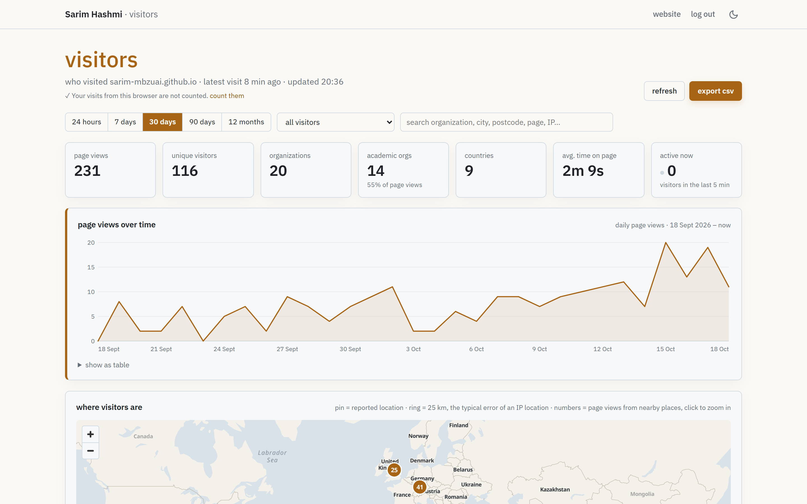

# Sarim Hashmi — Personal Website

Personal academic site of Sarim Hashmi (Research Engineer, MBZUAI), live at **https://sarim-mbzuai.github.io**.

A static [Astro](https://astro.build) site deployed to GitHub Pages, with a self-hosted **visit tracker** that shows which universities and organizations read the site, which papers they looked at and for how long. The tracker runs on Cloudflare's free plan, sets no cookies, and keeps the data in your own account.

---

## Contents

- [Stack](#stack)
- [Repository layout](#repository-layout)
- [Local development](#local-development)
- [Editing content](#editing-content)
- [Deployment](#deployment)
- [Visit tracker](#visit-tracker)
  - [What it does](#what-it-does)
  - [How it is wired into the site](#how-it-is-wired-into-the-site)
  - [The Cloudflare side](#the-cloudflare-side)
  - [Enabling it from scratch](#enabling-it-from-scratch)
  - [Day-to-day operations](#day-to-day-operations)
  - [Turning it off or deleting it](#turning-it-off-or-deleting-it)
  - [Limits, costs and privacy](#limits-costs-and-privacy)
- [Changelog](#changelog)

---

## Stack

- **Framework**: Astro 4, static output (`output: 'static'` in `astro.config.mjs`)
- **Styling**: vanilla CSS with custom properties in `public/styles/global.css`
- **Fonts**: Instrument Serif (display), Newsreader (serif), Manrope (sans), from Google Fonts
- **Theme**: light/dark toggle, persisted in `localStorage` under the key `theme`
- **Backdrop**: dependency-free canvas animation (`public/assets/js/bg.js`) and ASCII scenes (`public/assets/js/scenes.js`)
- **Analytics**: the self-hosted visit tracker described below (Cloudflare Worker + D1). `Layout.astro` also still loads GoatCounter in production builds; remove that `<script>` if you no longer want it.
- **Deploy**: GitHub Actions → GitHub Pages (`.github/workflows/deploy.yml`)

## Repository layout

```
src/
├── pages/
│   ├── index.astro             # Home: bio, news, featured publications
│   ├── publications.astro      # All publications
│   ├── experience.astro        # Work experience
│   ├── projects.astro          # Projects
│   ├── awards.astro            # Awards
│   ├── contact.astro           # Contact + public visitor map
│   └── visitors.astro          # Private tracker dashboard at /visitors/ (password protected)
├── components/
│   ├── Header.astro            # Nav, logo, theme toggle
│   ├── Footer.astro
│   ├── ThemeToggle.astro
│   ├── Scenes.astro
│   ├── PublicationItem.astro   # One publication (tagged with data-vt-context for the tracker)
│   ├── ExperienceItem.astro    # One job or project (tagged with data-vt-context)
│   ├── AwardItem.astro
│   ├── VisitTracker.astro      # Tracker snippet, rendered in <head> by Layout.astro
│   └── VisitorMap.astro        # City-level world map on the contact page
├── layouts/
│   └── Layout.astro            # Base HTML, meta, theme bootstrap, tracker snippet
└── data/
    ├── publications.json       # featured: true shows an entry on the home page
    ├── experience.json
    ├── projects.json
    ├── awards.json
    ├── news.json
    └── visit-tracker.json      # Tracker on/off switch and the Worker URL

public/
├── images/profile.jpg
├── styles/global.css
└── assets/js/{bg.js, scenes.js}

visit-tracker/                  # The Cloudflare Worker, its database schema and setup script
├── src/index.js                # Worker: collection, reverse DNS, sign-in, dashboard API, CSV, hourly jobs
├── src/classify.js             # Device parsing, academic / cloud network detection, bot filter
├── migrations/                 # D1 schema (0001 visits, 0002 network labels, 0003 reloads, 0004 activity)
├── scripts/set-password.mjs    # Sets the dashboard password (stores only a salted hash)
├── setup.sh                    # One-command setup
├── wrangler.toml               # Worker configuration
├── docs/                       # Screenshots used in visit-tracker/README.md
└── README.md                   # Full tracker documentation
```

## Local development

```bash
npm install
npm run dev       # http://localhost:4321
npm run build     # static output in dist/
npm run preview   # serve dist/ locally
```

In development the site talks to a **local** tracker on `http://localhost:8787`, never to the live one. Start it with `npm run dev` inside `visit-tracker/` (see [Day-to-day operations](#day-to-day-operations)); without it, page views in dev are simply dropped.

## Editing content

- **Publications**: `src/data/publications.json`. `featured: true` shows the entry on the home page. `links` supports `paper`, `code`, `blog`, `website`.
- **Experience**: `src/data/experience.json`. `link` is a URL or `null`; bullet text supports `[text](url)` links.
- **Projects**: `src/data/projects.json`.
- **Awards**: `src/data/awards.json` (`title`, `description`, `date`).
- **News**: `src/data/news.json` (newest first; `isNew` highlights an entry).
- **Bio**: the `<section class="about-section">` block in `src/pages/index.astro`.

## Deployment

Every push to `main` runs `.github/workflows/deploy.yml`, which installs dependencies, runs `npm run build` and publishes `dist/` to GitHub Pages. A deploy takes a few minutes. Nothing else is needed for the site itself; the tracker's Worker is deployed separately (below) and does not change when the site is rebuilt.

---

## Visit tracker

### What it does

Each page view is reported to a small Cloudflare Worker, which stores it in a D1 (SQLite) database together with everything Cloudflare knows about the request:

| Recorded                 | Example                                                                    |
| ------------------------ | -------------------------------------------------------------------------- |
| Time                     | 18 Oct 2026, 14:03:12, in your time zone and the visitor's                 |
| Organization / network   | Stanford University, Max Planck Society, Google LLC, Etisalat              |
| Network hostname         | `eduroam-12.wlan.cam.ac.uk` → `cam.ac.uk` (reverse DNS)                    |
| Network type             | academic, cloud / VPN / proxy, or other (plus your own labels)             |
| Location                 | City, region, postcode, country, coordinates (from the IP, city-level)     |
| Page                     | Path and title, time on screen, time actively reading, scroll depth        |
| What they did            | Which paper or section they read and for how long, downloads, links, email clicks, forms, videos, copied text |
| Whole visits             | The pages of one visit in order, and whether the visitor came before       |
| Problems                 | 404 pages reached through broken links, JavaScript errors                  |
| Came from                | Referring site (Scholar, LinkedIn, arXiv, …) and `utm_source`              |
| Device                   | Desktop / mobile / tablet, OS, browser, screen size, language              |
| IP address               | Kept 365 days, then erased automatically                                   |

Nothing typed on the site is ever recorded, nor mouse movements. Bots and headless browsers are dropped.

The private dashboard lives at **https://sarim-mbzuai.github.io/visitors/** (password protected, not linked, not indexed). The full feature list, screenshots and the reasoning behind the design are in [visit-tracker/README.md](visit-tracker/README.md).

<p align="center">
  
</p>

### How it is wired into the site

Four files on the site side, one of which is configuration:

1. **`src/data/visit-tracker.json`**, the switch:

   ```json
   {
     "enabled": true,
     "url": "https://visit-tracker.sarim-mbzuai.workers.dev"
   }
   ```

   `enabled: false` or an empty `url` removes the snippet, the map and the dashboard's connection from the build. In `npm run dev` the URL is ignored and `http://localhost:8787` is used instead.

2. **`src/components/VisitTracker.astro`**, the snippet. `Layout.astro` renders it in `<head>` of every page when the switch is on. It sends a `/hit` beacon on load and `/leave` beacons with time on page, active time, scroll depth and the activity since the last report. Elements marked `data-vt-context="Title"` (every publication and experience entry) get reading time and clicks attributed to that title; `data-vt-section="Name"` counts reading time only; `data-vt-event="Name"` records clicks on one element.

3. **`src/pages/visitors.astro`**, the dashboard. A self-contained page served at `/visitors/`. It reads the Worker URL from a `<meta>` tag, asks for the password, and then calls the Worker's `/api/*` endpoints with a signed token kept in `localStorage` for 30 days.

4. **`src/components/VisitorMap.astro`**, the public map on the contact page. It reads the Worker's `/map` endpoint, which returns only city-level counts.

### The Cloudflare side

Everything below lives in the Cloudflare account that ran the setup (see **Workers & Pages** and **Storage & Databases → D1** in the Cloudflare dashboard).

| Resource                     | Value                                                             |
| ---------------------------- | ----------------------------------------------------------------- |
| Worker name                  | `visit-tracker`                                                   |
| Worker URL                   | `https://visit-tracker.sarim-mbzuai.workers.dev`                  |
| D1 database                  | `visits` (id in `visit-tracker/wrangler.toml`)                    |
| Secret                       | `DASHBOARD_PASSWORD_HASH`: salted PBKDF2 hash of the dashboard password; the password itself is stored nowhere |
| Variables (`wrangler.toml`)  | `ALLOWED_ORIGINS = https://sarim-mbzuai.github.io`, `IP_RETENTION_DAYS = 365` |
| Rate limits                  | 60 visit events per minute per IP; 5 sign-in attempts per minute per IP |
| Cron                         | hourly (`17 * * * *`): refreshes the public map cache and erases IP addresses older than the retention period |
| Compatibility date           | `2026-05-01` (the newest the pinned wrangler supports)            |

The Worker's endpoints:

| Endpoint          | Who can call it                       | Purpose                                            |
| ----------------- | ------------------------------------- | -------------------------------------------------- |
| `POST /hit`       | pages on an allowed origin            | a page view                                        |
| `POST /leave`     | pages on an allowed origin            | time on page, scroll, activity, reading time       |
| `GET /map`        | anyone (CORS `*`)                     | city-level counts for the contact-page map         |
| `POST /api/login` | anyone, rate limited                  | password → 30-day token                            |
| `GET /api/*`      | holders of a valid token              | summary, visits, sessions, events, visitor history, CSV export, network labels |

Only `ALLOWED_ORIGINS` may report visits; a request without that `Origin` header is refused with 403. Forged requests are still possible with a script, which is why the rate limit exists.

### Enabling it from scratch

Use this on a new machine, a new Cloudflare account, or a fork of this repository.

**Prerequisites**

- Node.js **20.3 or newer** (wrangler is pinned to 4.86.0 for Node 20; with Node 22 you can bump it in `visit-tracker/package.json`)
- A free **Cloudflare account**. You can create it during setup; no card is needed.
- On Windows, **Git Bash** (installed with Git). Run the commands below in Git Bash, not PowerShell.

**Steps**

1. Put your site's origin(s) in `visit-tracker/wrangler.toml`:

   ```toml
   ALLOWED_ORIGINS = "https://your-user.github.io"
   ```

   For a fork, also replace `sarim-mbzuai.github.io` and `Sarim Hashmi` in `src/pages/visitors.astro` (title, brand, subtitle).

2. From the repository root:

   ```bash
   bash visit-tracker/setup.sh
   ```

   The script is safe to re-run; every step skips work that is already done. It will:

   1. install wrangler (Cloudflare's CLI) locally in `visit-tracker/node_modules`;
   2. open a browser tab to log in to Cloudflare (`wrangler login`) and ask you to allow access;
   3. create the D1 database `visits` and write its id into `wrangler.toml`;
   4. apply the migrations in `visit-tracker/migrations/`;
   5. deploy the Worker. The first time, it asks you to register a `workers.dev` subdomain: answer **yes** and pick a short name. This becomes part of your Worker URL and is hard to change later;
   6. ask you to type the dashboard password twice (hidden; at least 8 characters) and store its hash as the secret;
   7. write the Worker URL into `src/data/visit-tracker.json` and set `enabled: true`.

3. Commit and push, so GitHub Pages rebuilds the site with the snippet:

   ```bash
   git add -A && git commit -m "Enable visit tracker" && git push
   ```

4. After the deploy, open `https://your-site/visitors/` and sign in **in every browser you use** (laptop, phone, …). A browser that has signed in is marked as yours and its visits are not counted, even after you log out. Until you do this, your own visits show up in the log.

**Doing it by hand** (what the script runs, from `visit-tracker/`):

```bash
npm install
npx wrangler login
npx wrangler d1 create visits                      # paste the id into wrangler.toml
npx wrangler d1 migrations apply visits --remote
npx wrangler deploy                                # prints the Worker URL
npm run password                                   # sets DASHBOARD_PASSWORD_HASH
# then put the Worker URL into src/data/visit-tracker.json
```

### Day-to-day operations

All commands run from `visit-tracker/`.

| Task                                  | Command                                                                 |
| ------------------------------------- | ----------------------------------------------------------------------- |
| See the data                          | open `/visitors/` on the site and sign in                               |
| Change the dashboard password         | `npm run password` (also signs out every browser)                       |
| Deploy after editing `src/` or `migrations/` | `npm run deploy` (applies pending migrations, then deploys)      |
| Live request log                      | `npm run logs`                                                          |
| Raw SQL on the live database          | `npx wrangler d1 execute visits --remote --command "SELECT ts, org, city, path FROM visits ORDER BY ts DESC LIMIT 20"` |
| Delete all recorded visits            | `npx wrangler d1 execute visits --remote --command "DELETE FROM events; DELETE FROM visits; DELETE FROM cache"` |
| Name a campus network                 | in the dashboard, **name this network** on any visit                    |

**Testing locally.** Run `npm run password:local` once (writes a hash to `.dev.vars`, which is git-ignored), then `npm run dev` for a local Worker with a local database on `http://localhost:8787`. In the repository root run `npm run dev` and open `http://localhost:4321/visitors/`. The local database starts empty.

**Updating the code from upstream.** The Worker, dashboard and classifier were ported from [atifquamar07/atifquamar07.github.io](https://github.com/atifquamar07/atifquamar07.github.io) (MIT). To pull a newer version: copy `visit-tracker/src/*.js` and any new `migrations/*.sql` verbatim, regenerate `src/pages/visitors.astro` from the upstream `_pages/visitors.html` (Astro frontmatter, `is:inline` scripts, `is:global` style, your name and domain, then the "site theme" block at the end of the stylesheet), copy the body of `_includes/visit_tracker.liquid` into `VisitTracker.astro`, and run `npm run deploy`.

### Turning it off or deleting it

- **Pause tracking**: set `"enabled": false` in `src/data/visit-tracker.json` and push. The Worker keeps running but receives nothing; the data stays.
- **Delete everything**: from `visit-tracker/`, run `npx wrangler delete` (the Worker and its secret) and `npx wrangler d1 delete visits` (the database). Then set `enabled: false` or remove the tracker files.

### Limits, costs and privacy

Cloudflare's free plan allows 100,000 Worker requests and 100,000 database writes per day, 5 million rows read per day and 5 GB of storage. A page view costs two requests and at most a few writes, so a personal academic site uses a small fraction of that. If a day's quota is ever exceeded, the remaining visits that day are not recorded; the website itself is unaffected.

IP addresses are personal data under GDPR and the UAE's PDPL. A short notice on the site is recommended, for example in the footer:

> This site keeps a basic visit log (time, page, approximate location and network, from your IP address) to understand its audience. No cookies are used and nothing is shared with third parties.

The tracker sets no cookies. The dashboard keeps its sign-in token and the "don't count me" flag in the browser's `localStorage`.

---

## Changelog

**2026-10-19** — Activity tracking
- Each page view now records active time, scroll depth, the paper or section being read (publications and experience entries carry `data-vt-context`), downloads, outbound links, email clicks, forms, videos, copied text, 404s and JavaScript errors
- Dashboard: "what visitors did" panel, per-visit details with the visitor's path and history, whole-visit mode, returning-visitor marks
- Worker: `events` table (migration 0004), new `/api/events`, `/api/visitor`, `/api/sessions` endpoints; deployed

**2026-10-18** — Visit tracker
- Self-hosted visitor log on Cloudflare Workers + D1, ported from the upstream tracker to Astro: page snippet, password-protected dashboard at `/visitors/`, public city-level map on the contact page
- Dashboard restyled to the site's palette and fonts
- Documentation and screenshots in `visit-tracker/README.md`

**2026-06-29** — Ambient canvas background, bio wording, extracurricular paragraph, Cursor × Evoost AI Hackathon 2026 win (news + award)

**2026-05-07** — Home-page bio collapsed behind a "See more" toggle

**2026-04-18** — Initial Astro scaffold; PhD-application rewrite of the bio; real Scholar and LinkedIn links; portrait
