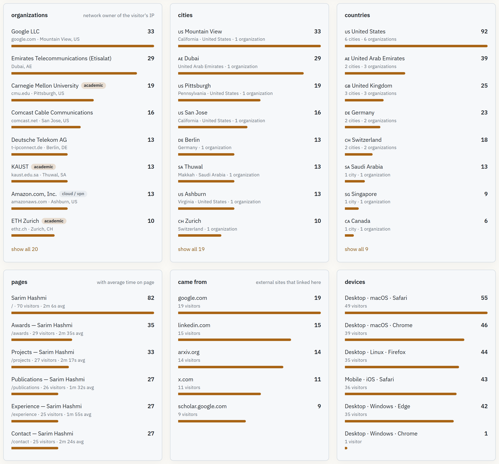
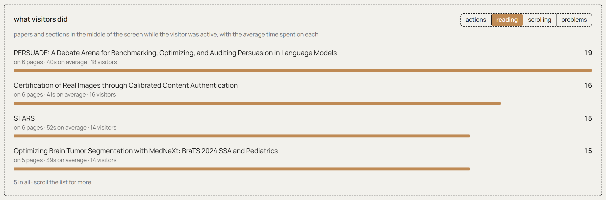
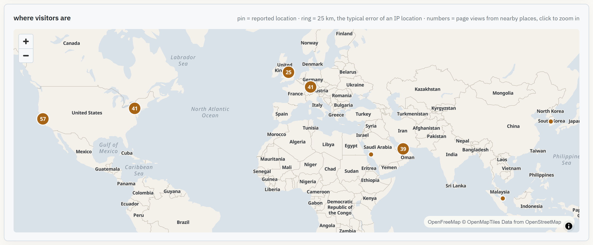
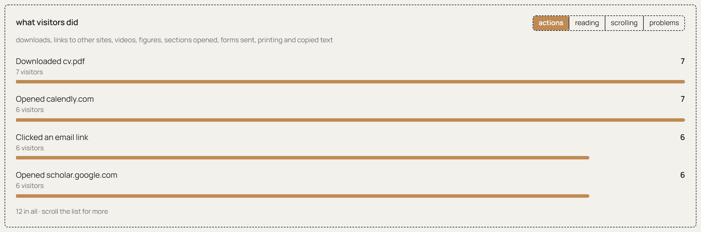
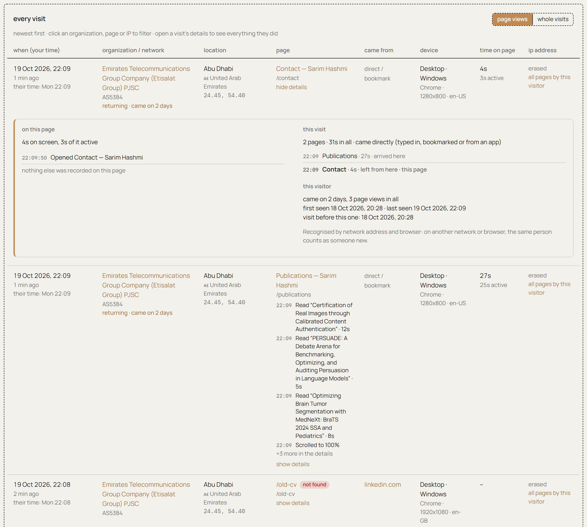
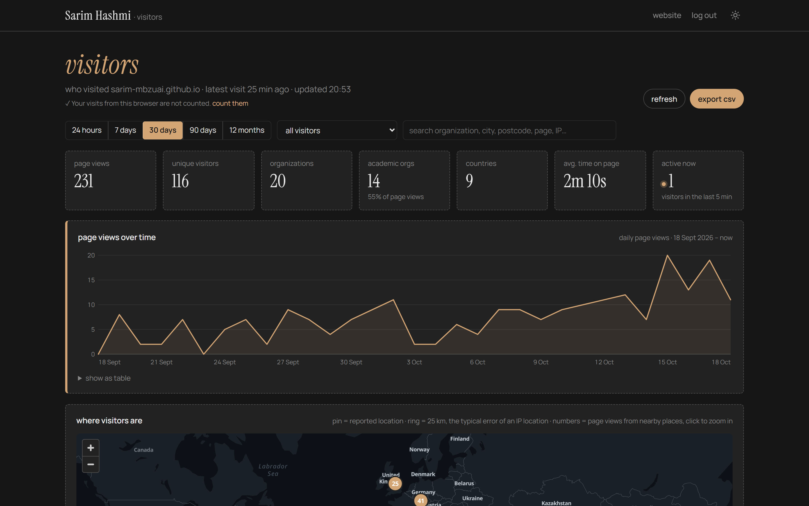
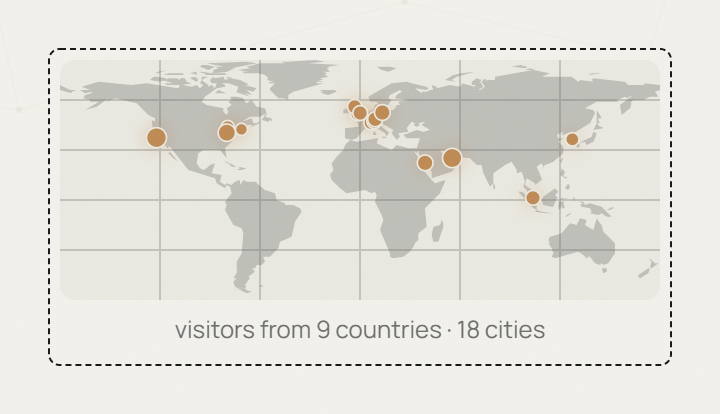

# Who is reading your website?

**A self-hosted visitor log for academic websites.** It tells you *which universities* open your site, which pages they read, how long they stay, and where they came from. It runs on Cloudflare's free plan, sets no cookies, and the data never leaves your own account.

<p align="center">
  
</p>

Google Analytics tells you *"1 visitor from Cambridge, Massachusetts"*. This tells you:

> **Massachusetts Institute of Technology** · `dhcp-18-9-44-120.dyn.mit.edu` · read **/publications** for 3 min 10 s · came from **scholar.google.com** · Tuesday 14:03, their time

If you are applying for PhDs, postdocs or faculty jobs, that difference matters. You can see when a lab you emailed actually opened your page, which publication they looked at, and whether they came back.

*All screenshots in this file show synthetic demo data, not real visitors.*

---

## What it records

One row per page view:

| What                   | Example                                                                   |
| ---------------------- | ------------------------------------------------------------------------- |
| Exact time             | 18 Oct 2026, 14:03:12, shown in your time and in the visitor's local time |
| Organization / network | Stanford University, Max Planck Society, Google LLC, Etisalat             |
| Network hostname       | `eduroam-12.wlan.cam.ac.uk` → domain `cam.ac.uk` (reverse DNS)            |
| Network type           | University / research, ISP / company, or cloud / VPN / proxy              |
| Location               | City, region, postcode, country, latitude/longitude                       |
| Page                   | Path and title, how long it was on screen and how much of that was active |
| What they did          | Papers and sections read (with time), downloads, links, videos, figures   |
| Whole visits           | Each visitor's pages in order, and whether they came on earlier days    |
| Problems               | Broken links (404 pages, with where the link was) and JavaScript errors   |
| Came from              | Referring site (Google Scholar, LinkedIn, arXiv, …) and `utm_source`      |
| Device                 | Desktop / mobile / tablet, OS, browser, screen size, language             |
| IP address             | Kept for 365 days, then erased automatically (configurable)               |

It never records names, emails, mouse movements or anything typed on the site (forms are recorded only by name when sent; search boxes not at all).

## How it knows it was a university

Three signals, combined:

1. **Who owns the network.** Cloudflare attaches the network owner (the ASN organization) to every request. Universities that own their IP space show up by name: *Carnegie Mellon University*, *ETH Zurich*, *University of Oxford*.
2. **Reverse DNS.** The Worker looks up the hostname of the visitor's address. Campus networks tend to have telling names: `eduroam-…`, `….cs.cmu.edu`, `….ox.ac.uk`. The dashboard shows the hostname and its domain next to each visit.
3. **An academic classifier.** A list of patterns (`university`, `institut`, `.edu`, `.ac.uk`, Max Planck, CNRS, national research networks such as JANET, DFN, GÉANT, Internet2, …) tags each visit as *academic*, *cloud / VPN / proxy*, or *other*. One click filters the whole dashboard to universities only.

<p align="center">
  
</p>

**Campus Wi-Fi that hides behind an ISP.** Many universities rent addresses from a telecom, so public records only name the provider. For those, click **name this network** on any visit, type the real name (for example *MBZUAI (campus Wi-Fi)*), and every past and future visit from that address or range is relabelled and counted as academic.

**Be honest with yourself about the limits.** A professor reading your site from home shows as their home ISP, not their university. A VPN shows as the VPN provider and is tagged *cloud / VPN / proxy* so it does not pollute the map. Location is city-level and can be a city off for mobile networks. Visitors with tracker blockers may not be counted at all.

## Which paper did they read?

Every publication and experience entry on the site is marked with `data-vt-context="<title>"`. While that entry is in the middle of the screen and the visitor is active (scrolling, moving the mouse, typing), the seconds are credited to that title, and any click inside it (the PDF, the code link, arXiv) is recorded as "Downloaded … · <title>" or "Opened arxiv.org · <title>". The dashboard then lists papers by how often and how long they were read. On other pages, the h2/h3 heading above the middle of the screen is used instead. To tag anything else, add `data-vt-context` (reading time and clicks) or `data-vt-section` (reading time only) to its container, or `data-vt-event="Name"` to a single link or button.

<p align="center">
  
</p>

## The dashboard

A private page at **`/visitors/`** on your own site. It is not linked anywhere and tells search engines not to index it. You sign in once per browser; the session lasts 30 days.

<p align="center">
  
</p>

- **Filters**: last 24 hours, 7, 30, 90 days or 12 months; *universities & research only*; *hide cloud, VPN & proxies*; free-text search over organization, city, postcode, page and IP.
- **Click anything** (an organization, a city, a country, a page, a referrer, a circle on the map) to filter everything else to it.
- **All pages by this visitor** shows one person's path through your site.
- **What visitors did**: *actions* (downloads, links to other sites, videos, figures, …), *reading* (each paper and section, with the average time spent on it), *scrolling*, and *problems* (broken links to the site, with where the link was, and JavaScript errors). Click a row to see the visits where it happened.
- **Show details** under a visit lists everything the visitor did on that page, the other pages of the same visit, and when they came before. **Whole visits** at the top of "every visit" lists visits instead of single page views.
<p align="center">
  
</p>

- **Reloads are merged**: opening the same page again within 30 minutes updates the visit instead of adding a new row.
- **Live count** of visitors in the last five minutes.
- **Export CSV** of every visit in the current filter.
- **The view is kept in the URL**, so you can bookmark *"academic visitors, last 90 days"*.
- **Dark mode**, following your site's theme.

<p align="center">
  
</p>

<p align="center">
  
</p>

## A public map for your visitors

Optionally, the contact page shows a small world map of where readers come from. It uses a public endpoint that returns **city-level counts only**: no IP addresses, no organizations, no timestamps, and cloud/VPN traffic is left out.

<p align="center">
  
</p>

## Setup (about 5 minutes)

You need **Node.js 20.3 or newer** and a **free Cloudflare account** (you can create it during setup). From the repository root:

```bash
bash visit-tracker/setup.sh
```

On Windows, run that line in **Git Bash** (installed with Git), not in PowerShell.

The script

1. installs Cloudflare's CLI (`wrangler`) locally,
2. opens a browser tab to log in to Cloudflare,
3. creates the `visits` database and its tables,
4. deploys the Worker and asks you to pick a `workers.dev` subdomain (answer **yes**),
5. asks you to type the dashboard password twice (hidden; only a salted hash is stored),
6. writes the Worker URL into `src/data/visit-tracker.json`.

Then publish the site:

```bash
git add -A && git commit -m "Enable visit tracker" && git push
```

Finally, open `https://<your-site>/visitors/` and sign in **once in every browser you use** (laptop, phone, …). Signed-in browsers are remembered and their visits are not counted, even after you log out.

The script is safe to re-run; every step skips work that is already done.

## Using it on your own site

This repository is an [Astro](https://astro.build) site, but nothing in the tracker depends on Astro.

- **Astro**: copy `visit-tracker/`, `src/components/VisitTracker.astro`, `src/components/VisitorMap.astro`, `src/pages/visitors.astro` and `src/data/visit-tracker.json`. Render `<VisitTracker endpoint={…} />` in the `<head>` of your layout (see `src/layouts/Layout.astro`). Put your domain in `ALLOWED_ORIGINS` in `visit-tracker/wrangler.toml`.
- **Jekyll, Hugo, plain HTML, anything else**: the page snippet is 40 lines of plain JavaScript (the body of `VisitTracker.astro`) and the dashboard is one self-contained HTML page (`visitors.astro` minus its five-line frontmatter). Paste the snippet into your base template with your Worker URL, serve the dashboard at `/visitors/`, and set `ALLOWED_ORIGINS`.

Each page view costs two Worker requests and at most three database writes. Cloudflare's free plan allows 100,000 requests and 100,000 writes per day, so an academic site uses a small fraction of it. If you ever exceed it, visits for the rest of that day are simply not recorded; the website itself is unaffected.

## Privacy

IP addresses are personal data under GDPR (EU visitors) and the UAE's PDPL. Add a short notice to your site, for example in the footer or on the contact page:

> This site keeps a basic visit log (time, page, approximate location and network, from your IP address) to understand its audience. No cookies are used and nothing is shared with third parties.

The tracker sets no cookies. IP addresses are erased after `IP_RETENTION_DAYS` (in `wrangler.toml`); everything else is kept. Bots, crawlers and headless browsers are dropped on purpose.

**Security**: the password is never stored, only a salted PBKDF2 hash in a Cloudflare secret. Sign-in is rate-limited to five attempts per minute per address. Every dashboard endpoint requires a signed token; the collection endpoints are write-only. Changing the password signs out every browser.

## Day-to-day commands

Run these from `visit-tracker/`:

```bash
npm run password      # change the dashboard password (typed, never saved)
npm run deploy        # deploy after editing src/ or migrations/
npm run logs          # live request log
npx wrangler d1 execute visits --remote --command \
  "SELECT ts, org, city, country, path FROM visits ORDER BY ts DESC LIMIT 20"
```

To try everything on your own computer: in `visit-tracker/`, run `npm run password:local` once, then `npm run dev` (tracker at `http://localhost:8787`). In the repository root, run `npm run dev` and open `http://localhost:4321/visitors/`. In development the site always talks to the local tracker, never to the live one.

To switch tracking off, set `"enabled": false` in `src/data/visit-tracker.json`. To delete everything, run `npx wrangler delete` and `npx wrangler d1 delete visits`.

`wrangler` is pinned to 4.86.0 because newer releases need Node.js 22. If you have Node 22, you can bump it in `package.json`.

## How it works

```
visitor's browser ──POST /hit, /leave──▶ Cloudflare Worker ──▶ D1 database (visits table)
  (VisitTracker.astro in every page)        │  adds location + network from Cloudflare,
                                            │  reverse DNS hostname, device, bot filtering
your-site/visitors/ ──password, then token──▶ Worker /api/*  (dashboard data)
contact page ──GET /map (public, city-level only)
```

| File                                   | Purpose                                                                  |
| -------------------------------------- | ------------------------------------------------------------------------ |
| `src/index.js`                         | The Worker: collection, reverse DNS, sign-in, dashboard API, CSV, hourly |
| `src/classify.js`                      | Device/browser parsing, academic/cloud network detection, bot filter     |
| `scripts/set-password.mjs`             | Sets the dashboard password (stores only a salted hash)                  |
| `migrations/`                          | Database schema                                                          |
| `wrangler.toml`                        | Worker configuration (allowed origins, IP retention, rate limits)        |
| `setup.sh`                             | One-command setup                                                        |
| `../src/data/visit-tracker.json`       | Worker URL and on/off switch used by the site                            |
| `../src/pages/visitors.astro`          | The dashboard page at /visitors/                                         |
| `../src/components/VisitTracker.astro` | The snippet added to every page (from `Layout.astro`)                    |
| `../src/components/VisitorMap.astro`   | The world map on the contact page                                        |

## Credits

The Worker and dashboard started from the visit tracker in [atifquamar07/atifquamar07.github.io](https://github.com/atifquamar07/atifquamar07.github.io) (MIT) and were ported to Astro here. Map tiles by [OpenFreeMap](https://openfreemap.org), data © OpenStreetMap contributors.
